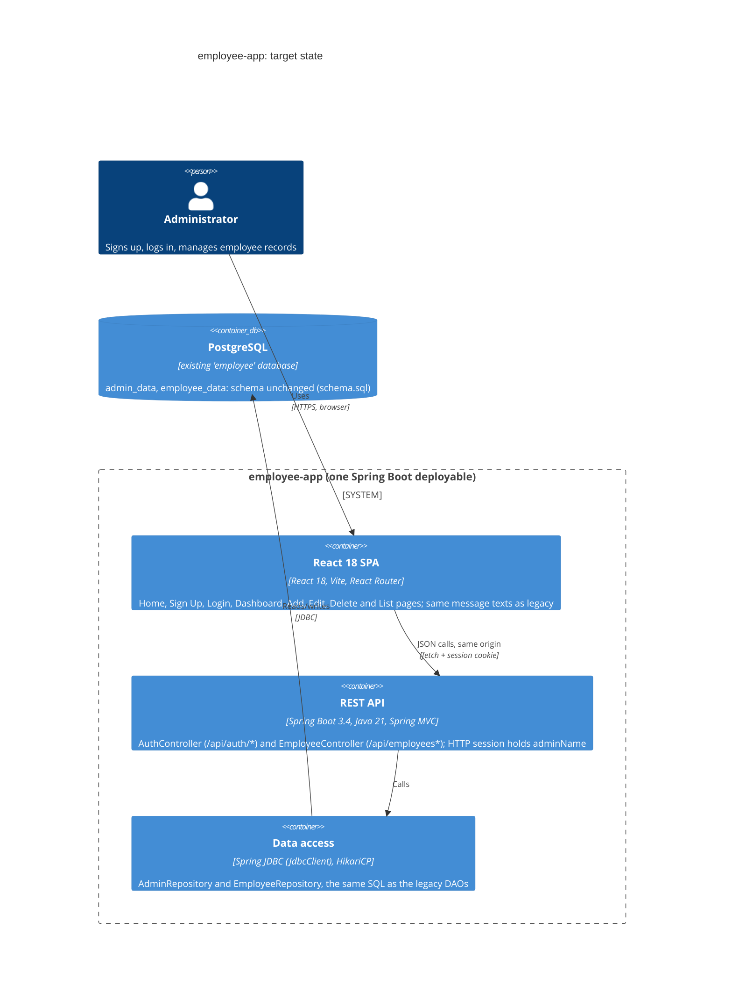
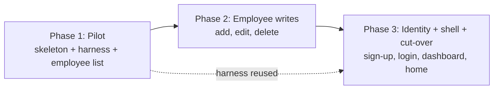

# Modernization Brief: employee-app

- **Status:** APPROVED, full plan (Arun, 2026-10-31); revised the same day by the approver (see "Approver revision" below)
- **Written:** 2026-10-31
- **Inputs (last modified):**
  - `INTENT.md` 2026-10-31 01:37
  - `PREFLIGHT.md` 01:38
  - `ARCHITECTURE.mmd` 01:41
  - `ASSESSMENT.md` 01:42
  - `call-graph.mmd`, `data-lineage.mmd`, `critical-path.mmd` 01:47
  - `topology.json` 01:49
  - `BUSINESS_RULES.md`, `DATA_OBJECTS.md` 12:35
  - `RULE_REVIEWS.json` 12:38
- **Path:** `transform` (cross-stack rewrite, one module group at a time), strangler-fig ordering
- **How to steer this plan:** edit this file. The build commands read the phase blocks in section 3 as binding. An edited criterion is honoured; a chat message is not. A build command may tick a box or add a note, but proposes any change to a criterion on a `Proposed revision:` line for you to accept.

---

## 1. Objective

Rewrite the Employee Management App from **Java 8 Servlets + JSP + plain JDBC on Tomcat 9** into a **Spring Boot 3.4 REST API (Java 21) and a React 18 single-page app**, with the **PostgreSQL schema unchanged**. The intent (INTENT.md) is a personal showcase of the Claude Code modernization plugin, and its bar is **"without missing anything from the legacy application"**. So the measure of success is not a cleaner design. It is that every screen, endpoint, validation, message, navigation path, session behaviour and database effect has a proven counterpart in the new app.

The system is small (0.98 KSLOC, complexity index 2.87, 25 business rules), self-contained (preflight Check 6), and both the legacy and target stacks build and run on this machine. Each slice can therefore be proven by **running both apps side by side** rather than by argument.

The reviewer confirmed three P0 rules (RULE-016/017/018) **as they behave today**, including login by ID and name with no password, and no login check on employee operations. The rewrite deliberately carries these across. Security hardening is a separate, later decision (`harden`), not part of this plan.

## 2. Target Architecture



**Design choices:**
- **One deployable.** The React build is served from Spring Boot's static resources, so the session cookie is same-origin, as it is today.
- **Spring JDBC, not JPA.** The repositories keep the legacy SQL text, so database behaviour is identical:
  - user-supplied IDs (RULE-019)
  - `DOUBLE PRECISION` salary (RULE-001)
  - exact, case-sensitive name match (RULE-008, RULE-013, RULE-017)
- **No Spring Security filter chain.** The reviewer confirmed RULE-018, so the employee endpoints stay open, as in the legacy app.

| Legacy component (topology id) | Target component |
|---|---|
| `index.jsp` | React `HomePage` (`/`) |
| `signup.jsp` | React `SignUpPage` (`/signup`) |
| `Login.jsp` (form + scriptlet login) | React `LoginPage` (`/login`) + `POST /api/auth/login` |
| `LoginServlet` (unreachable) | Kept as `POST /LoginServlet` compatibility endpoint, or dropped (open question Q7) |
| `SignUpServlet` (`/SignupServlet`) | `POST /api/auth/signup` |
| `Welcome.jsp` (dashboard, greeting, fake logout) | React `DashboardPage` (`/welcome`) + `GET /api/auth/me`; Logout navigates home without ending the session (RULE-015) |
| `addEmployee.jsp` / `AddEmployeeServlet` | React `AddEmployeePage` + `POST /api/employees` |
| `editEmployee.jsp` / `EditEmployeeServlet` | React `EditEmployeePage` + `PATCH /api/employees/{id}` (body: name, field, newValue) |
| `deleteEmployee.jsp` / `DeleteEmployeeServlet` | React `DeleteEmployeePage` + `DELETE /api/employees/{id}?name=` |
| `showEmployee.jsp` / `ShowEmployeeServlet` | React `EmployeeListPage` + `GET /api/employees` |
| `Employee`, `Admin` (models) | Java `record Employee`, `record Admin` (+ request DTOs from DATA_OBJECTS.md) |
| `EmployeeDAO`, `AdminDAO` | `EmployeeRepository`, `AdminRepository` (Spring JDBC) |
| `DBUtil` + `context.xml` (JNDI pool) | Spring Boot auto-configured HikariCP `DataSource`; `application.yml` with `SPRING_DATASOURCE_*` from the environment |
| `styles.css` + inline JSP styles | Shared React CSS reproducing the same look (gradient background, cards, button colours) |
| `schema.sql` | **Unchanged.** Used as-is to provision test databases; not migrated, not altered. |
| `build.xml` (Ant) | Maven build (Spring Boot plugin + `frontend-maven-plugin` for the React build) |

Target code lives under `modernized/employee-app/` (`backend/`, `frontend/`). The legacy source is never edited.

## 3. Phased Sequence

Strangler-fig order: the lowest-risk, read-only slice first, then the writes, then identity and the shell, then cut-over. Until cut-over, the legacy WAR keeps running unchanged, and the new app runs beside it against its own copy of the schema.

**Phase 1 is a pilot, and this brief is a hypothesis.** Phase 1 builds the skeletons and the side-by-side equivalence harness on the smallest real slice. What it surfaces is *expected* to revise this brief, and regenerating the brief after the pilot is the normal path. Examples: a session or cookie difference, a message-rendering decision, a JDBC type quirk.


### Approver revision (2026-10-31)

The approver said, word for word: *"Please give appropriet messages in case of error. Also, create a modern asthetic UI in react. And also create entire app in one go"*. This changes the plan as follows; every other part of the plan stands:

1. **One build pass.** Phases 1–3 are built together, in one `transform` run over all their modules. Each phase's exit criteria still apply, and they are checked together at the end.
2. **Proper error messages (approved deviations from legacy behaviour).** Wherever the legacy app fails silently, shows a server error page or shows a misleading message, the new app shows a clear message. Specifically:
   - RULE-025: the database being unavailable is reported, not shown as an empty list.
   - RULE-014: a failed delete shows "Employee not found!".
   - A non-numeric ID on edit or delete gets a validation message, not an HTTP 500 page.
   - Edit reports an unknown employee, an invalid field and an invalid salary separately.
   - Text over 255 characters gets a length message.
   - The database being unavailable gets a "couldn't reach the database" message.
   
   Legacy message texts are kept verbatim where they already exist.
3. **Modern UI.** The React app gets a modern design; the JSP look is no longer reproduced. Parity is proven on behaviour, message text, navigation and data, not on visuals.

The confirmed P0 rules (RULE-016/017/018) are unaffected.



#### Phase 1 — Pilot: skeletons, equivalence harness, employee list
Command: /code-modernization:modernize-transform
Modules: ShowEmployeeServlet, showEmployee.jsp, EmployeeDAO, Employee, DBUtil, context.xml
Scale: S
Risk: Low; (1) the side-by-side harness is new infrastructure, so if it is wrong every later proof is wrong. Mitigation: the harness must first detect a deliberately planted difference. (2) Salary text formatting (`15000.0`, `1.0E7`, RULE-002) differs between Java and JavaScript. Mitigation: the API returns the legacy-formatted string alongside the number, and the test compares the rendered text.
Entry criteria:
- [x] Open questions Q1–Q4 in section 7 are answered in this file
- [x] This brief is approved in section 8 (Phase 1 or full plan)
- [ ] Legacy WAR builds and runs locally on Tomcat 9 with JDK 8 (`JAVA_HOME=/Library/Java/JavaVirtualMachines/jdk-1.8.jdk/Contents/Home`), as proven in PREFLIGHT.md
- [ ] First slice named: `ShowEmployeeServlet` → `GET /api/employees` + `EmployeeListPage`
Exit criteria:
- [ ] `modernized/employee-app/backend` builds with Maven on JDK 21 and Spring Boot 3.4.x; `frontend` builds with React 18.3.x
- [ ] Integration tests run against PostgreSQL provisioned from the unchanged `schema.sql` (Testcontainers or the local Postgres 18)
- [ ] The equivalence harness runs legacy and new side by side on identical seeded data, and fails on a planted difference
- [ ] RULE-002, RULE-023 and RULE-025 are covered by passing equivalence tests: same rows, same row set, same salary text, empty table on a read failure
- [ ] A `git diff` of `schema.sql` and of every legacy source file is empty

#### Phase 2 — Employee write operations: add, edit, delete
Command: /code-modernization:modernize-transform
Modules: AddEmployeeServlet, EditEmployeeServlet, DeleteEmployeeServlet, addEmployee.jsp, editEmployee.jsp, deleteEmployee.jsp
Scale: M
Risk: Medium; (1) the confirmed quirks must survive the rewrite and not be "fixed" by framework defaults: edit by ID only with no salary checks (RULE-016, RULE-007), delete by exact ID and name (RULE-013), server-only validation differing from the browser's (RULE-010). Mitigation: each quirk is an explicit equivalence test, and Bean Validation annotations are not used on these DTOs unless they reproduce legacy limits exactly. (2) Error presentation moves from `<script>alert()` responses to JSON plus React. Mitigation: the decision in Q2 fixes the message texts and where they appear, and tests compare the text.
Entry criteria:
- [ ] Phase 1 exit criteria all ticked
- [x] Open questions Q5 and Q6 in section 7 are answered in this file
- [ ] First slice named: `AddEmployeeServlet` → `POST /api/employees` + `AddEmployeePage`
Exit criteria:
- [ ] The P0 rule RULE-016 is proven equivalent by side-by-side tests, including name ignored, negative/NaN/Infinity salary accepted, case-insensitive field, unknown field rejected
- [ ] RULE-003, 004, 005, 006, 007, 010, 011, 013, 014 and 024 are each covered by passing equivalence tests
- [ ] Every legacy message text for add, edit and delete appears verbatim in the new UI
- [ ] Database state after each scenario is identical between legacy and new (row-by-row comparison)

#### Phase 3 — Identity, dashboard shell and cut-over
Command: /code-modernization:modernize-transform
Modules: index.jsp, signup.jsp, Login.jsp, SignUpServlet, LoginServlet, Admin, AdminDAO, Welcome.jsp, styles.css
Scale: M
Risk: Medium; (1) session semantics change from a server-rendered JSESSIONID to an SPA calling a JSON API. Mitigation: keep a server-side HTTP session with the `adminName` attribute, and add tests for login, the greeting, the fake logout that keeps the session (RULE-015) and access without login (RULE-018). (2) Losing a navigation path during cut-over. Mitigation: all four persona flows in section 4 are replayed end to end in both apps before the WAR is retired.
Entry criteria:
- [ ] Phase 2 exit criteria all ticked
- [x] Open question Q7 (LoginServlet) in section 7 is answered in this file
- [ ] First slice named: `SignUpServlet` → `POST /api/auth/signup` + `SignUpPage`
Exit criteria:
- [ ] The P0 rules RULE-017 and RULE-018 are proven equivalent by side-by-side tests:
  - login by exact ID and name with no password
  - name not trimmed at login
  - generic error message
  - every employee endpoint reachable without a session
- [ ] RULE-008, 009, 012, 015 and 020 are each covered by passing equivalence tests
- [ ] All four persona flows in section 4 pass end to end in both apps with identical outcomes
- [ ] `/code-modernization:modernize-verify employee-app` returns a verdict for every module, and each difference is accepted or fixed
- [ ] The new app runs as one Spring Boot deployable against the existing `employee` database, with the schema unchanged

## 4. Business Walkthroughs

**Register as an administrator.** Persona: a new administrator.

| Step (business language) | Legacy modules | Replaced in |
|---|---|---|
| Open the home page and choose Sign Up | `index.jsp`, `signup.jsp` | Phase 3 |
| Submit admin ID and name | `signup.jsp` → `SignUpServlet` | Phase 3 |
| ID checked to be a whole number; admin saved (a duplicate ID is refused) | `SignUpServlet`, `AdminDAO`, `admin_data` | Phase 3 |
| "Sign up successful", then go to login | `SignUpServlet` → `Login.jsp` | Phase 3 |

**Log in to the dashboard.** Persona: an administrator.

| Step | Legacy modules | Replaced in |
|---|---|---|
| Open the login page | `index.jsp` → `Login.jsp` | Phase 3 |
| Submit ID and name (the page posts to itself) | `Login.jsp` | Phase 3 |
| ID and name matched against registered admins (no password, RULE-017) | `Login.jsp`, `AdminDAO`, `admin_data` | Phase 3 |
| The admin's name is remembered for the visit | `Login.jsp` → `HttpSession` | Phase 3 |
| Dashboard shows "Welcome, <name>!" | `Welcome.jsp` | Phase 3 |

**Add an employee and see the list.** Persona: an administrator.

| Step | Legacy modules | Replaced in |
|---|---|---|
| Choose Add Employee | `Welcome.jsp` → `addEmployee.jsp` | Phase 3 (dashboard) / Phase 2 (form) |
| Submit ID, name, department and salary | `addEmployee.jsp` → `AddEmployeeServlet` | Phase 2 |
| Validate: all fields, whole-number ID, numeric salary ≥ 0 | `AddEmployeeServlet` | Phase 2 |
| Save the employee (a duplicate ID is reported) | `EmployeeDAO`, `employee_data` | Phase 2 (DAO in Phase 1) |
| Open and show the employee list | `ShowEmployeeServlet`, `showEmployee.jsp` | **Phase 1** |

**Update or remove an employee.** Persona: an administrator.

| Step | Legacy modules | Replaced in |
|---|---|---|
| Choose Update and submit ID, name, field, new value | `editEmployee.jsp` → `EditEmployeeServlet` | Phase 2 |
| Update that one field by ID; the name is not checked (RULE-016) | `EmployeeDAO`, `employee_data` | Phase 2 |
| Choose Remove and submit ID and name | `deleteEmployee.jsp` → `DeleteEmployeeServlet` | Phase 2 |
| Delete only if ID and name both match | `EmployeeDAO`, `employee_data` | Phase 2 |
| Return to the dashboard (even when nothing was deleted, RULE-014) | `DeleteEmployeeServlet` → `Welcome.jsp` | Phase 2 |

## 5. Behavior Contract

These P0 rules must be proven equivalent before the phase that covers them ships. All three were **confirmed as correct and wanted by a person** in `RULE_REVIEWS.md` (2026-10-31). Their Medium extraction confidence is therefore resolved, and **none is a blocker**.

| Rule | Behaviour that must be reproduced | Phase | Review |
|---|---|---|---|
| RULE-016 | Edit changes only salary or department, found by ID alone. The entered name is required but never checked. A salary edit accepts any parseable number, including negatives. Field names are case-insensitive, and any other field gives "Employee not found or invalid data!" | 2 | Confirmed: "keep edit-by-ID only, with no salary checks on edit and no name confirmation" |
| RULE-017 | Admin login succeeds only when the ID and the exact, case-sensitive, untrimmed name match an `admin_data` row. There is no password. Failure gives "Invalid ID or Name. Please try again." | 3 | Confirmed: "keep ID + name login exactly as today, with no password" |
| RULE-018 | Add, edit, delete and list run without a login. Logout does not end the session. | 3 (and open endpoints from Phases 1–2) | Confirmed: "keep employee operations open, with no login required, as today" |

**Extended parity suite.** Because the intent says *"without missing anything"*, every other rule in `BUSINESS_RULES.md` (RULE-001 to RULE-025, excluding unanswered items in section 7) also becomes an equivalence test in the phase listed in section 3. P1/P2 rules are not release gates in the plugin's sense, but this plan treats them as exit criteria.

## 6. Validation Strategy

| Phase | Characterization tests (legacy) | Side-by-side diff (legacy vs new, same inputs) | Contract tests (API) | Property-based | Manual UAT |
|---|---|---|---|---|---|
| 1 | Pin the list output, salary text and empty-table-on-failure against the running WAR | Yes: rendered rows and DB reads | `GET /api/employees` schema | Salary formatting over random doubles (Java `Double.toString` parity) | Check the list page looks the same |
| 2 | Pin every add/edit/delete outcome: message text, landing page, DB state | Yes: DB rows after each scenario, plus the user-visible message | `POST`, `PATCH`, `DELETE` on `/api/employees` | Random IDs, names and salary strings, including whitespace, NaN, Infinity and negatives | Walk through add, edit and delete |
| 3 | Pin sign-up, login, the greeting, logout and anonymous access | Yes: session attribute, redirects, DB rows | `/api/auth/*` | Name casing and whitespace in login and sign-up | All four persona flows end to end in both apps |

**Harness design.**
- Legacy runs on Tomcat 9 (JDK 8) and the new app on Spring Boot (JDK 21).
- Each test seeds an identical fresh database from `schema.sql`, drives the same scenario through both apps, and compares user-visible text, landing page and the final contents of `admin_data` and `employee_data`.
- `verify` re-checks the result independently after Phase 3.

## 7. Open Questions

Answer each one by editing this file (tick the box and write the answer under it). Q1–Q4 block Phase 1, Q5–Q6 block Phase 2 and Q7 blocks Phase 3. Q8–Q12 can be answered at any point, but each must be settled before the phase that owns its rule ships.

- [x] **Q1: Java version.** Spring Boot 3.4 needs Java 17+; JDK 17.0.12 and 21.0.9 are both installed (PREFLIGHT.md). *Recommendation: Java 21 (LTS, the version the preflight smoke test proved).*
  - **Answer (2026-10-31, Arun):** Java 21.
- [x] **Q2: How the legacy browser `alert()` pop-ups appear in React.** Legacy servlets reply with `<script>alert('…')</script>` and then navigate. *Recommendation:* keep every message text **verbatim** and the same landing page, but show the text as an in-page notice rather than `window.alert`. Parity is checked on text and destination, not on the pop-up mechanism. Alternative: call `window.alert` for pixel-level parity.
  - **Answer (2026-10-31, Arun):** Keep every message text verbatim and the same landing page, shown as an in-page notice (not window.alert). Parity is checked on text and destination. **Revised:** modern UI (approver revision, item 3).
- [x] **Q3: Spring Boot and React versions.** INTENT.md fixes Spring Boot 3.4 and React 18. Both are behind the current releases as of 2026-10 (Spring Boot 3.4 is past open-source support). *Recommendation: keep 3.4.x and React 18.3.x as stated, and note an upgrade as follow-up work.*
  - **Answer (2026-10-31, Arun):** Keep Spring Boot 3.4.x and React 18.3.x as stated; an upgrade is noted as follow-up work.
- [x] **Q4: XSS behaviour change on the list page.** Legacy prints employee names and departments unescaped (`showEmployee.jsp:33-34`, SEC-004), so a name containing `<script>` runs. React escapes by default, so the new app shows such a name as text. *Recommendation: accept this as the one deliberate difference; reproducing script execution is not reasonable.*
  - **Answer (2026-10-31, Arun):** Accepted as the one deliberate difference: React escapes names and departments.
- [x] **Q5: RULE-003 and RULE-004 overlap** (both describe add-employee validation). *Recommendation: treat them as one rule in tests.* Likewise RULE-021 and RULE-022 (the unused `validateEmployee`).
  - **Answer (2026-10-31, Arun):** Treat RULE-003/004 as one rule in tests, and RULE-021/022 as one.
- [x] **Q6: RULE-014, a failed delete.** Today the "Employee not found!" alert is lost and the user lands on the dashboard as if the delete worked. Reproduce this exactly, or show the not-found message? *Parity default: reproduce.* SME question: "Should a failed delete send the user back to the delete form with an error, or to the Welcome page?"
  - **Answer (2026-10-31, Arun):** ~~Reproduce exactly~~ **Revised by the approver:** show "Employee not found!" (approver revision, item 2).
- [x] **Q7: RULE-020, `LoginServlet`.** It is unreachable from the UI but is a live URL (`POST /LoginServlet`). Keep a compatibility endpoint with its weaker input handling, or drop it? *Recommendation: drop it, since nothing in the app calls it; record this as an accepted difference.*
  - **Answer (2026-10-31, Arun):** Drop `LoginServlet`; recorded as an accepted difference.
- [x] **Q8: RULE-001, salary meaning.** Is it annual or monthly, and in which currency? Should it stay `DOUBLE PRECISION` (the schema is frozen), with no rounding? *Parity default: unchanged.*
  - **Answer (2026-10-31, Arun):** Unchanged: DOUBLE PRECISION, no rounding, units not defined (as today).
- [x] **Q9: RULE-011, department.** Is it free text (as today) or a fixed list? *Parity default: free text.*
  - **Answer (2026-10-31, Arun):** Free text (as today).
- [x] **Q10: RULE-019, IDs.** Keep user-typed IDs (as today)? *Parity default: yes.* If they ever become generated, the identity sequences must be reset first.
  - **Answer (2026-10-31, Arun):** Keep user-typed IDs (as today).
- [x] **Q11: RULE-024, success messages.** Edit and delete store a success message that is never shown. Keep it invisible (parity) or show it on the dashboard? *Parity default: invisible.*
  - **Answer (2026-10-31, Arun):** Keep the success message invisible (as today).
- [x] **Q12: RULE-023, list order.** Today there is no `ORDER BY`, so order is whatever PostgreSQL returns. *Parity default: same query; tests compare rows as a set, not in order.*
  - **Answer (2026-10-31, Arun):** Same query, no ORDER BY; tests compare rows as a set.

## 8. Approval Block

```
Approved by: Arun  Date: 2026-10-31
Approval covers: Full plan
```

Recorded from the approver's instruction: "Accept all recommendations and approve the full plan". Every recommendation and parity default in section 7 was accepted as written.
